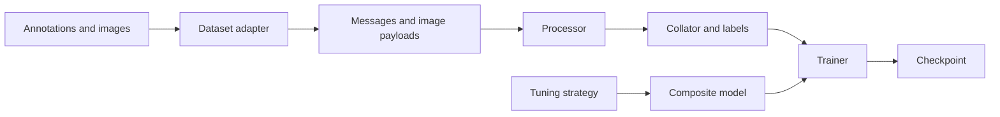

# Architecture

TinyLLaVA Factory separates model composition, input processing, training policy,
and evaluation. Training, batch evaluation, and interactive inference share
the model-loading and processor interfaces.

## Model components

`TinyLlavaConfig` describes three components:

- `text_config`: the language model.
- `vision_config`: the vision encoder.
- `connector_config`: the projection from visual features to language-model embeddings.

`TinyLlavaForConditionalGeneration` provides `forward` and `generate`.
Load a complete checkpoint with `from_pretrained`, or assemble initial
components with `from_pretrained_components`.

The processor combines the tokenizer, image processor, and chat template.
It aligns image placeholders with visual tokens and prepares model inputs.

## Training data flow

The adapter normalizes the dataset schema. The processor encodes text and
images, and the collator pads sequences and creates loss labels from assistant
masks. The tuning strategy selects trainable parameters and configures PEFT;
the Trainer handles optimization and checkpointing.

## Evaluation and inference

The checkpoint loader returns a model and its processor. Generation helpers
encode conversations, call the model, and decode responses. Evaluation tasks
provide input loaders and benchmark-specific scoring or export steps.

Use `tinyllava.eval.batch_generation` for datasets,
`tinyllava.eval.single_turn` for command-line inference, and
`tinyllava.serve.app` for the Web UI.

## CLI and execution responsibilities

`tinyllava.cli` dispatches training, evaluation, and conversation entry points.
`utils/config.py` expands recursive `from` references with OmegaConf merging.
Training and evaluation workflows resolve stage inheritance, checkpoints, paths,
and execution steps. Multi-stage experiments select algorithm and data within
each stage, with shared model, training, and launcher defaults at the root.

`hparams/arguments.py` defines project parameter objects for training and evaluation.
`hparams/training.py` owns training structure validation, batch derivation, and argument construction;
`hparams/hf.py` contains the HF `TrainingArguments` subclass, imported when
constructing training worker inputs so workflow validation stays lightweight.
`EvalArguments(**config)` validates flat evaluation parameters after the workflow
resolves paths and removes its metadata.

`train/algorithms/sft.py` runs supervised training and `sft_trainer.py` contains
its Trainer and sampler extensions. `train/strategy/` implements freezing and LoRA.
Other algorithms belong beside SFT inside `algorithms/`, reusing shared parameters
while defining their data, batch semantics, and loop. `runner.py` executes
commands, manages processes, and merges outputs. Evaluation tasks own their
adapters, conversion, and scoring steps.

## Module responsibilities

| Module | Responsibility |
| --- | --- |
| `tinyllava.model` | Composite configuration, model, vision encoders, and connectors |
| `tinyllava.data` | Dataset adapters, processor creation, templates, and collator |
| `tinyllava.train` | Training entry point, tuning strategies, and sampling |
| `tinyllava.eval` | Generation, task loaders, and evaluators |
| `tinyllava.hparams` | Parameter types, configuration validation, and HF argument adaptation |
| `tinyllava.utils` | YAML composition, checkpoint discovery, and loading |
| `tinyllava.serve` | Interactive Web UI |

See the [extension guide](guides/extending.md) and [API reference](reference/model.md)
for implementation details.

The [v2 roadmap](roadmap.md#deepstack-hooks) describes the proposed Qwen3-VL-style
DeepStack Hook plugin: vision components produce auxiliary features, the composite
model maps them to visual positions, and layer adapters inject them into native HF
decoders. Its standalone prototype guides the next integration milestones.
