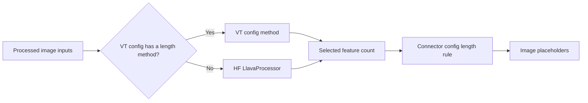
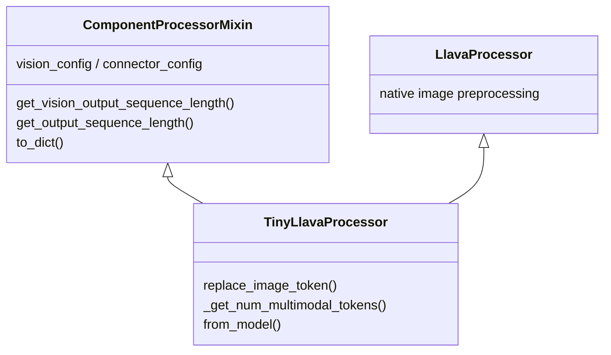

# Extending TinyLLaVA

Use the active interfaces in the [architecture](../architecture.md). Model
construction, tuning policy, data transformation, and scoring are separate
responsibilities.

| Extension | Entry point |
| --- | --- |
| Language model | Hugging Face text config and `language_model_name_or_path` |
| Vision tower | HF Auto registration, lazy `AutoVisionTowerModel`, and `AutoImageProcessor` |
| Connector | `tinyllava.model.connector.auto` config/model mappings |
| Dataset schema | `tinyllava.data.adapters` |
| Chat format | `model.chat_template_path` and Jinja generation blocks |
| Tuning policy | `tinyllava.train.strategy` |
| Training algorithm | `tinyllava.train.algorithms` |
| Evaluation task | `tinyllava.eval.tasks.auto` loader/evaluator mappings |

A connector must implement the current config/model contract and produce
features compatible with the language model's hidden size. Register its config
and model in the canonical auto mappings and test save/load round trips.

A custom chat template must render image placeholders consistently and mark
assistant output with `` blocks. Validate rendered prompts and
assistant masks before training to check which tokens contribute to the loss.

For new datasets, adapt the source schema to normalized messages and image
payloads. Keep dataset-specific path handling in the adapter.

Add API directives to the relevant [reference page](../reference/data.md) when
introducing public interfaces.

## Vision models and MoF

Native CLIP, SigLIP, DINOv2 and other compatible HF vision backbones load through
`AutoVisionTowerModel`, which combines project and native HF mapping names.
TinyLLaVA extracts the vision sub-config from CLIP/SigLIP composite
configs. Project vision types use the `__tlf_vision_tower` suffix. Register runtime
extensions explicitly in `VISION_TOWER_CONFIG_MAPPING` and `AutoVisionTowerModel`;
HF Auto registration is separate. Custom models must return spatial token hidden states and expose compatible
`hidden_size`, `patch_size` and image-token metadata. The saved preprocessing
configuration selects `AutoImageProcessor`.

MoF comes from Tong et al., [Eyes Wide Shut? Exploring the Visual Shortcomings
of Multimodal LLMs](https://arxiv.org/abs/2401.06209) (CVPR 2024).
[TinyLLaVA Factory, Table 2](https://arxiv.org/html/2405.11788v1) cites this
method. Its upstream `mof_mlp.py` implements **I-MoF**: separate CLIP and DINOv2
MLPs followed by spatial token interleaving. The migrated implementation retains
that behavior, including the shared CLIP-preprocessed image for both branches.
A-MoF is also supported: set the vision config's `fusion_strategy="additive"`
and `alpha` to mix `alpha * CLIP + (1 - alpha) * DINOv2` before a shared connector.
This requires equal branch feature widths and token layouts. Select an ordinary connector, such as MLP,
for A-MoF. `MofConnector` implements the separate-branch I-MoF path.

- `MofVisionConfig` stores both branch configs; `MofVisionModel` has HF
  construction and save/load behavior, without downloads during construction.
- Branches must share patch size, channel count and depth. DINOv2 interpolates
  its positions to the CLIP input resolution. Branch hidden widths may differ in interleaved mode.
- `MofConnector` projects each branch independently and produces tokens in
  `clip_0, dino_0, clip_1, dino_1, ...` order. Multiple selected hidden layers
  remain separate per branch before projection.
- `TinyLlavaProcessor` obtains placeholder counts from the connector config's
  `get_output_sequence_length` method. I-MoF maps N selected tokens to 2M,
  where M is the common output length of the two branch connectors.
- All connectors receive `vision_hidden_size`, `text_hidden_size` and
  `vision_feature_layer`. Each connector validates its own input contract and
  delegates `get_output_sequence_length` to its config.

Prepare a reusable MoF vision checkpoint once:

```python
from transformers import AutoImageProcessor
from tinyllava.model.vision_tower.mof import MofVisionModel

clip_path = "openai/clip-vit-large-patch14-336"
vision = MofVisionModel.from_pretrained_components(
    clip_model_name_or_path=clip_path,
    dinov2_model_name_or_path="facebook/dinov2-large",
)
vision.save_pretrained("output/mof-vision")
AutoImageProcessor.from_pretrained(clip_path).save_pretrained("output/mof-vision")
```

MoF stores the two packed feature widths in its own connector config as
`vision_hidden_sizes` (CLIP first, DINOv2 second). Their sum must match
`vision_hidden_size`. Change the two widths when using other branches.

`clip_config` and `dinov2_config` inside `MofConnectorConfig` independently select
registered connector types through `AutoConnectorModel`. Configure MLP settings
inside each branch. For example:

```yaml
model_type: mof__tlf_connector
vision_hidden_sizes: [1024, 1024]
clip_config:
  model_type: resampler__tlf_connector
  num_queries: 32
dinov2_config:
  model_type: qformer__tlf_connector
  num_queries: 32
```

Both output lengths must match for interleaving. Learned queries do not inherently
preserve spatial patch correspondence; this combination is an experiment, not
the paper's spatial I-MoF recipe. The default branch connectors remain independent
MLPs. Both current vision branches retain CLS at index zero: `default` removes
both CLS features before the connectors; `full` retains them. For additive MoF,
the corresponding CLS features mix before selection. Register-token variants
are outside this CLIP + ordinary DINOv2 configuration.

To create an A-MoF checkpoint, pass `fusion_strategy="additive", alpha=0.5` to
`MofVisionModel.from_pretrained_components`, then select a shared connector such
as `configs/connectors/mlp2x_gelu.yaml`. Its length rule determines the final token count.

Then select both the vision tower and its connector explicitly:

```bash
python -m tinyllava.cli train --config configs/experiments/qwen2_instruct.yaml --steps pretrain \
  model.vision_model_name_or_path=output/mof-vision \
  model.connector.from=mof \
  experiment_name=qwen2_mof
```

The complete checkpoint includes both branches and projections. Use
`AutoVisionTowerModel` for deferred loading of a standalone MoF checkpoint.
Package and configuration imports leave model implementations unloaded; the
local lazy mapping resolves MoF only when it is selected. To use HF `AutoModel`
directly for MoF, explicitly import `MofVisionModel` to register its class.
Use `tinyllava.data.processor.AutoProcessor.from_pretrained` to load a saved
processor lazily. Direct HF `AutoProcessor` loading of a custom processor requires
an explicit `TinyLlavaProcessor` import to register its class.
The local tests cover small-model numerical behavior and save/load round trips.

### Other multi-encoder designs

| Design | Fusion | Implication for extension |
| --- | --- | --- |
| [Prismatic](https://arxiv.org/abs/2402.07865) | DINOv2 + SigLIP patch features concatenate by channel; see the [implementation](https://github.com/TRI-ML/prismatic-vlms/blob/main/prismatic/models/backbones/vision/dinosiglip_vit.py) | Equal spatial grids can use channel-packed features, with separate branch preprocessing |
| [BRAVE](https://brave-vlms.epfl.ch/) | Project encoder features to a common width, concatenate along the sequence, then query with MEQ-Former | Different input sequence lengths can feed a fixed-length output |
| [Cambrian-1](https://cambrian-mllm.github.io/cambrian-1/) | Spatial Vision Aggregator queries local regions across multiple encoders and can aggregate again within the LLM | Requires explicit spatial layout and potentially changes to the language-model path |

The present MoF packing remains an aligned two-branch implementation. A future
multi-VT interface should preserve each branch's preprocessing, token layout,
and feature selection until its chosen fusion operation.


## Vision and connector token lengths

`vision_feature_select_strategy` can be omitted. After resolving the vision
sub-config, `TinyLlavaConfig` selects `full` for SigLIP/SigLIP2 to keep every
patch, and `default` for CLIP, DINO and MoF to remove the leading CLS token
while retaining DINO register tokens. Custom vision configs can declare
`num_additional_image_tokens`; zero selects `full` by default. The model and
processor share this metadata and resolved selection. Explicit settings take
precedence, and checkpoints store the resolved strategy and retain it on reload
unless an override is supplied.

`ComponentProcessorMixin` persists `vision_config` and `connector_config`.
`TinyLlavaProcessor` combines this mixin with HF `LlavaProcessor`.
For each processed image, `replace_image_token` first checks whether the vision
config defines `get_output_sequence_length`. If present, that method receives
the image processor's output and the image index; otherwise the processor uses
HF `LlavaProcessor.replace_image_token`. The resulting selected-feature count
then passes through the connector's length rule.



The optional vision-config method has this signature:

```python
def get_output_sequence_length(
    self,
    image_inputs: dict,
    image_idx: int,
    *,
    vision_feature_select_strategy: str,
) -> int:
    # Example for a custom tower whose selected features form this grid.
    return int(image_inputs["image_grid_thw"][image_idx].prod())
```

Return the non-negative integer number of features **after feature selection,
before the connector**. The example assumes the image processor supplies the grid
and the tower's selection preserves those patches. A real implementation must
account for its own selection policy, padding and extra tokens. It must agree
with the features actually passed to the connector. MoF's vision features are
packed by channel, so its vision count is N; its connector produces 2N.

Register custom config types in `VISION_TOWER_CONFIG_MAPPING`, with unique model
types, so the method is restored with a saved processor. Runtime registrations
must be repeated in a new process.

The private `_get_num_multimodal_tokens` query is not used by the current training
or generation flow. It continues to estimate ordinary LLaVA-compatible inputs.
For a custom vision length rule it raises `NotImplementedError` on size-only
queries: original image dimensions alone cannot reconstruct arbitrary processed
metadata. Use actual processed inputs, or implement an estimator in a specialized
processor when a consumer needs one. Errors in custom length methods propagate to the caller.

### Survey of common vision architectures

The following engineering survey was checked against Transformers in October
2026. It describes the length contract and model integration needed for each family.

| Family | Relevant token behavior | Consequence for the length contract |
| --- | --- | --- |
| [CLIP](https://huggingface.co/docs/transformers/model_doc/clip), plain DINOv2 | Regular patch grid plus CLS | HF fallback fits; `default` removes CLS |
| [SigLIP](https://huggingface.co/docs/transformers/model_doc/siglip) | Patch sequence without CLS | HF fallback fits with `full` selection and zero additional tokens |
| [DINOv2 with registers](https://github.com/huggingface/transformers/blob/main/src/transformers/models/dinov2_with_registers/modeling_dinov2_with_registers.py), [DINOv3 ViT](https://huggingface.co/docs/transformers/model_doc/dinov3) | CLS, register tokens, then patches | Construction counts `1 + num_register_tokens`; current `default` removes only CLS, retaining registers |
| [SigLIP2 NaFlex](https://github.com/huggingface/transformers/blob/main/src/transformers/models/siglip2/modeling_siglip2.py) | Patchified padded inputs, spatial shapes and attention masks | A grid or valid-token count must agree with actual feature selection; counting valid patches alone does not remove padded features |
| [Qwen3-VL](https://github.com/huggingface/transformers/blob/main/src/transformers/models/qwen3_vl/processing_qwen3_vl.py) | Grid-based patches followed by spatial merging | Separate the pre-merger count from merger reduction; positional and model-forward integration also need adaptation |
| [InternVL](https://github.com/huggingface/transformers/blob/main/src/transformers/models/internvl/processing_internvl.py) | Multiple image tiles, per-tile downsampling, image boundary markers | Tile count and connector operation scope must be explicit; prompt markers remain processor-owned |
| [LLaVA-NeXT](https://github.com/huggingface/transformers/blob/main/src/transformers/models/llava_next/processing_llava_next.py), [Pixtral](https://github.com/huggingface/transformers/blob/main/src/transformers/models/pixtral/processing_pixtral.py) | Unpadding/newline features or row/end markers affect the packed sequence | A length hook alone does not implement the architecture's feature packing or placeholder pattern |

The native register-token case is covered with tiny randomly initialized DINOv2
and DINOv3 models: placeholder counts are compared with actual feature lengths.
The custom hook is tested with grid metadata, multiple connector rules and
processor save/load. The [v2 roadmap](../roadmap.md#native-qwen3-vl) covers
end-to-end dynamic-resolution VLM integration.

## Custom image processors

`tinyllava.data.image_processor` is the lazy extension point used by training
and inference. HF-native image processors continue to use HF's own resolution.
For a project-specific processor, add a package such as
`tinyllava/data/image_processor/custom/` exporting `CustomImageProcessor`, then
add `("custom__tlf_image_processor", "CustomImageProcessor")` to
`CUSTOM_IMAGE_PROCESSOR_MAPPING_NAMES` in `image_processor/auto/auto_mappings.py`.
Use a unique class name and save it as `image_processor_type` with
`save_pretrained`. Only the processor selected by this metadata is imported.

## Connector implementations

Connector packages contain `configuration_<name>.py`, `modeling_<name>.py`,
and a lazy `__init__.py`.
Use `MLPConnectorConfig(depth=1)` for a linear projection. Identity validates
that the concatenated vision width equals the language-model width.

Resampler uses learned Perceiver queries. Q-Former uses the maintained HF
`Blip2QFormerModel`, initialized from config without downloading BERT. Both
produce `num_queries` tokens per image. All TinyLLaVA connectors use the
same `TinyLlavaProcessor`, which persists the connector config and calls its
sequence-length method. Processor loading imports connector config classes.
Train Resampler and Q-Former weights for their current architectures.
Freezing is controlled by the tuning strategy.

The processor Auto mapping is keyed by the composite `TinyLlavaConfig`, as in
HF's model/processor relationship. Adding a connector length rule requires
implementing `get_output_sequence_length(input_length)` in its config. MLP/Identity preserve N,
MoF returns 2N, and query connectors return their configured fixed count.
Model-side splitting delegates to the same method, avoiding duplicate rules.

## Custom multimodal processors

A new input pipeline, such as video, can implement HF `ProcessorMixin`.
Register its model config and processor class with the
project `AutoProcessor.register(MyConfig, MyProcessor)`.
`AutoProcessor.from_config(config, **kwargs)` selects the class and passes only
`kwargs` to its constructor. Pass processor-specific settings explicitly.
`ComponentProcessorMixin` provides configuration serialization and two opt-in
helpers: `get_vision_output_sequence_length(image_inputs, image_idx, **kwargs)`
returns the custom VT count, or `None` when the concrete processor should use its
native calculation; `get_output_sequence_length(input_length)` applies the
connector rule, preserving the input length when no connector is configured.
The concrete processor owns placeholder expansion and feature selection.

Compose it before the native HF class, as in
`TinyLlavaProcessor(ComponentProcessorMixin, LlavaProcessor)`. A concrete class
must explicitly declare its sub-processors and serializable settings in
`__init__`: HF uses that signature to discover and reload processor components.
It also decides when to call the helpers. For example, Qwen3-VL's native image
count already includes its spatial merger; applying another connector rule
requires an explicit architectural decision. Video timestamps and delimiters
remain the native processor's responsibility.

`TinyLlavaProcessor` owns LLaVA placeholder expansion, default length estimates,
and `from_model`. The latter synchronizes image tokens and model embeddings,
then constructs the registered processor through Auto with LLaVA-specific
arguments. Other architectures should construct their registered processor with
their own arguments. Native Qwen3-VL integration is planned in the
[v2 roadmap](../roadmap.md#native-qwen3-vl).




For lazy package extensions, add config and processor class names to
`PROCESSOR_CONFIG_MAPPING_NAMES` and `PROCESSOR_MAPPING_NAMES`, and their full
module paths to `PROCESSOR_CONFIG_MODULE_NAMES` and `PROCESSOR_MODULE_NAMES`.
Saved processors are selected by `processor_class`; runtime registrations must
be repeated in a new process. Use unique processor class names. The selected
implementation handles video processing.

## Language models

`AutoLanguageModel` and `AutoLanguageModelForCausalLM` merge project and native
HF mapping names, inheriting HF lookup and enumeration behavior. Local module
resolution is the only model-mapping override. Runtime extensions register
explicitly with the project config/model mappings; HF registrations are separate.
Project language types use `__tlf_language_model`. OpenELM retains the official
`openelm` model type so official checkpoint configs can be read. Config imports
do not load modeling modules or weights.

OpenELM is retained because the project has an OpenELM preset and the current
Transformers dependency does not supply it. Its canonical implementation lives
in `tinyllava.model.llm.openelm`, using HF Cache, GenerationMixin, standard
embedding accessors and tied output weights. The official shared-embedding
270M config is supported locally. The implementation preserves layer parameter
names; the unused legacy backbone classifier was removed. See the bundled
[Apple license](https://huggingface.co/apple/OpenELM-270M-Instruct/blob/main/LICENSE).

Use the project Auto loaders to select OpenELM lazily. For standalone HF
`AutoModel`/`AutoModelForCausalLM` loading, import the corresponding OpenELM
class first to activate its public HF registration. Composite models derive
the tied input-embedding path through `get_input_embeddings()` rather than
assuming a particular language model's internal attribute name.

Validation uses tiny offline checkpoints, cached versus uncached decoding,
left padding, multimodal training, and checkpoint round trips.

The planned [DeepStack Hook plugin](../roadmap.md#deepstack-hooks) adds visual
residuals at selected native decoder layers. The roadmap describes the prototype,
adapter responsibilities, and training/generation acceptance criteria.

## Training algorithms

Add an algorithm module under `tinyllava/train/algorithms/` and register its path
in that package's `__init__.py`. SFT is implemented in `sft.py`.

Modules expose `SECTIONS`, `validate_config`, `prepare_config(config, world_size=...)`,
and `run(config)`. Conventional Trainer algorithms reuse `hparams/training.py`.
Reward or rollout sections belong to their algorithm. An RL algorithm with
different batch semantics can replace preparation without changing other algorithms'
parameters or the launcher.

Keep validation and preparation lightweight; import trainers and load models only
inside `run`. The workflow owns stage dependencies and launch, while
`train/strategy/` owns parameter update policies. Algorithms receive the configuration
assembled by the shared `from` feature.
