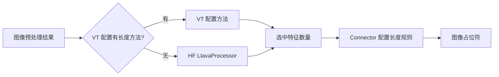
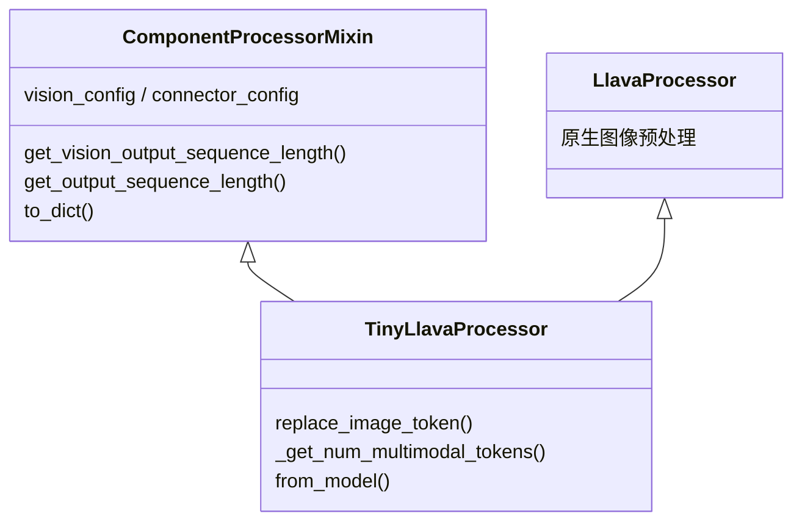

# 扩展 TinyLLaVA

模型构建、调优策略、数据转换和评分是独立职责，应使用当前规范接口。

| 扩展目标 | 入口 |
| --- | --- |
| 语言模型 | HF text config、`language_model_name_or_path` |
| 视觉编码器 | HF Auto 注册、懒加载 `AutoVisionTowerModel` 和 `AutoImageProcessor` |
| 连接器 | `tinyllava.model.connector.auto` |
| 数据格式 | `tinyllava.data.adapters` |
| 对话模板 | `model.chat_template_path`、Jinja generation block |
| 调优策略 | `tinyllava.train.strategy` |
| 训练算法 | `tinyllava.train.algorithms` |
| 评测任务 | `tinyllava.eval.tasks.auto` |

连接器输出维度必须匹配语言模型，并验证 config/model 保存加载往返。对话模板应正确放置图像占位符，用 `` 标记 assistant 输出；在训练前检查实际渲染结果和监督 mask。

新增数据源应转换为统一消息和图像载荷，数据集专有路径由 adapter 处理。新增公开接口时更新对应 API 页面。参见[架构](../architecture.md)。

## 视觉模型与 MoF

原生 CLIP、SigLIP、DINOv2 及接口兼容的 HF 视觉模型通过 `AutoVisionTowerModel` 合并后的项目与 HF 原生命名映射加载。
CLIP/SigLIP 的完整配置会先提取视觉子配置。项目视觉类型使用 `__tlf_vision_tower` 后缀。运行时扩展显式注册到
`VISION_TOWER_CONFIG_MAPPING` 和 `AutoVisionTowerModel`，HF 注册独立维护。模型应
返回空间 token 的 hidden states，并提供匹配的 `hidden_size`、`patch_size` 和图像
token 元数据。预处理类由 checkpoint 保存的配置交给 `AutoImageProcessor` 解析。

MoF 来自 Tong 等人的 [Eyes Wide Shut? Exploring the Visual Shortcomings of
Multimodal LLMs](https://arxiv.org/abs/2401.06209)（CVPR 2024）；
[TinyLLaVA Factory 表 2](https://arxiv.org/html/2405.11788v1) 明确引用了该方法。
上游 `mof_mlp.py` 实现的是 **I-MoF**：CLIP 与 DINOv2 分别经过独立 MLP，之后按空间
位置交错排列 token。迁移保留这一语义，以及两路共用 CLIP 预处理图像的原有约定。
也支持 A-MoF：在视觉配置中设置 `fusion_strategy="additive"` 和 `alpha`，在共享
connector 之前计算 `alpha * CLIP + (1 - alpha) * DINOv2`。直接相加要求两路特征
维度和 token 布局相同。A-MoF 应选择 MLP 等普通
connector；`MofConnector` 专用于分别投影的 I-MoF 路径。

- `MofVisionConfig` 保存两个分支配置，`MofVisionModel` 支持标准构造与保存加载，
  构造函数不下载模型。
- 两路 patch size、通道数和深度必须相同，interleaved 模式下隐藏维度可以不同。DINOv2 的位置编码
  插值到 CLIP 输入分辨率。
- `MofConnector` 独立投影后输出 `clip_0, dino_0, clip_1, dino_1, ...`。
  同时选择多个隐藏层时，各层特征仍按分支分别送入投影。
- `TinyLlavaProcessor` 通过 connector 配置的 `get_output_sequence_length`
  获取占位符数量。I-MoF 将 N 个选中特征映射为 2M 个输出 token，M 为两路 connector 相同的输出长度。
- 所有 connector 都接收 `vision_hidden_size`、`text_hidden_size` 和 `vision_feature_layer`。
  各实现负责输入校验，输出长度计算委托给 connector 配置。

先将两个预训练分支组装为可复用的视觉 checkpoint：

```python
from transformers import AutoImageProcessor
from tinyllava.model.vision_tower.mof import MofVisionModel

clip_path = "openai/clip-vit-large-patch14-336"
vision = MofVisionModel.from_pretrained_components(
    clip_model_name_or_path=clip_path,
    dinov2_model_name_or_path="facebook/dinov2-large",
)
vision.save_pretrained("output/mof-vision")
AutoImageProcessor.from_pretrained(clip_path).save_pretrained("output/mof-vision")
```

MoF 在自己的 connector 配置中用 `vision_hidden_sizes` 声明拼接特征的两个宽度
（依次为 CLIP、DINOv2），并校验总和等于 `vision_hidden_size`。
更换分支时应同步配置两个宽度。

`MofConnectorConfig` 内的 `clip_config`、`dinov2_config` 分别通过
`AutoConnectorModel` 选择已注册的 connector。MLP 参数写在各分支内部。例如：

```yaml
model_type: mof__tlf_connector
vision_hidden_sizes: [1024, 1024]
clip_config:
  model_type: resampler__tlf_connector
  num_queries: 32
dinov2_config:
  model_type: qformer__tlf_connector
  num_queries: 32
```

交错排列要求两路输出长度相同。学习得到的 query 并不天然保持空间 patch 对应关系，
此组合属于扩展实验，并非原论文空间 I-MoF 配方。默认仍为两个独立 MLP。
当前两个视觉分支均在第 0 位保留 CLS：`default` 在 connector 前同时删除两个 CLS，
`full` 则保留；Additive 模式先混合对应 CLS 再执行选择。带 register token 的变体
不属于当前 CLIP + 普通 DINOv2 配置。

构建 A-MoF checkpoint 时，向 `MofVisionModel.from_pretrained_components` 传入
`fusion_strategy="additive", alpha=0.5`，再选择 `configs/connectors/mlp2x_gelu.yaml`
等共享 connector，最终 token 数由该 connector 的长度规则确定。

通过现有配置入口显式选择视觉塔和对应 connector：

```bash
python -m tinyllava.cli train --config configs/experiments/qwen2_instruct.yaml --steps pretrain \
  model.vision_model_name_or_path=output/mof-vision \
  model.connector.from=mof \
  experiment_name=qwen2_mof
```

完整 checkpoint 保存两路视觉权重及投影。使用 `AutoVisionTowerModel` 按需加载
独立 MoF checkpoint。导入包或配置不会加载模型实现，只有选中 MoF 时才解析对应模块。
直接使用 HF `AutoModel` 加载 MoF 时，先显式导入 `MofVisionModel` 完成类注册。
使用 `tinyllava.data.processor.AutoProcessor.from_pretrained` 懒加载已保存的 processor；
直接使用 HF `AutoProcessor` 加载自定义 processor 时，先显式导入 `TinyLlavaProcessor` 完成注册。本地测试验证小模型数值行为和保存加载往返，
论文 benchmark 分数仍需训练与评测验证。

### 其他多编码器设计

| 设计 | 融合方式 | 对扩展的意义 |
| --- | --- | --- |
| [Prismatic](https://arxiv.org/abs/2402.07865) | DINOv2 + SigLIP patch 特征沿通道拼接，见[实现](https://github.com/TRI-ML/prismatic-vlms/blob/main/prismatic/models/backbones/vision/dinosiglip_vit.py) | 相同空间网格可使用通道打包，但各分支仍有自身预处理 |
| [BRAVE](https://brave-vlms.epfl.ch/) | 各编码器特征投影到相同维度，沿序列拼接，再由 MEQ-Former 查询 | 不同输入序列长度可汇聚为固定长度输出 |
| [Cambrian-1](https://cambrian-mllm.github.io/cambrian-1/) | Spatial Vision Aggregator 查询多编码器局部区域，并可在 LLM 内再次聚合 | 需要显式空间布局，也可能需要扩展语言模型路径 |

当前 MoF 仍是对齐双分支实现。后续多 VT 接口应保留各分支的预处理、token 布局和
特征选择，直到执行指定融合操作。

## 视觉塔与连接器的 token 长度

`vision_feature_select_strategy` 可以省略。`TinyLlavaConfig` 在解析视觉子配置后
确定默认值：SigLIP/SigLIP2 使用 `full`，保留所有 patch；CLIP、DINO 和 MoF 使用
`default`，去掉首个 CLS token，保留 DINO 的 register tokens。自定义视觉配置可通过
`num_additional_image_tokens` 声明额外 token 数，为零时默认使用 `full`。
模型和 processor 共用这份元数据与解析结果。显式设置优先，checkpoint 保存确定后的
策略；后续加载未提供覆写时保留 checkpoint 设置。

`ComponentProcessorMixin` 保存 `vision_config` 和 `connector_config`，
`TinyLlavaProcessor` 将该 Mixin 与 HF `LlavaProcessor` 组合。处理每张图像时，
`replace_image_token` 先检查 VT 配置是否定义 `get_output_sequence_length`：有则传入
image processor 的处理结果和图像索引；没有则调用 HF `LlavaProcessor.replace_image_token`。
得到选中特征的数量后，再应用 connector 的长度规则。



VT 配置上的可选方法签名如下：

```python
def get_output_sequence_length(
    self,
    image_inputs: dict,
    image_idx: int,
    *,
    vision_feature_select_strategy: str,
) -> int:
    # 示例：自定义视觉塔选中的特征对应这个网格。
    return int(image_inputs["image_grid_thw"][image_idx].prod())
```

返回值是**特征选择之后、connector 之前**的非负整数长度。示例假定 image processor
提供网格，且视觉塔的选择策略保留这些 patch；具体实现必须处理自身的选择策略、padding
和额外 token，并与真正传给 connector 的特征一致。MoF 在通道维打包视觉特征，VT
长度为 N，connector 才将其变为 2N。

自定义配置使用唯一模型类型注册到 `VISION_TOWER_CONFIG_MAPPING`，以便保存的 processor
恢复相同的方法。运行时注册需要在新进程重新执行。

私有 `_get_num_multimodal_tokens` 查询未被当前训练和生成流程调用。普通 LLaVA 兼容
输入继续使用原有预估；带自定义 VT 长度规则时，仅提供尺寸的查询会抛出
`NotImplementedError`，因为原始图像尺寸不能还原任意预处理元数据。可使用实际预处理
结果；若调用者需要尺寸预估，由专用 processor 实现。自定义长度方法的错误直接传递给调用方。

### 常见视觉架构调研

以下工程调研于 2026 年 10 月对照 Transformers 核查，列出各系列所需的长度契约与模型集成工作。

| 系列 | 相关 token 行为 | 对长度契约的影响 |
| --- | --- | --- |
| [CLIP](https://huggingface.co/docs/transformers/model_doc/clip)、普通 DINOv2 | 规则 patch 网格加 CLS | 可沿用 HF 默认公式，`default` 去掉 CLS |
| [SigLIP](https://huggingface.co/docs/transformers/model_doc/siglip) | 无 CLS 的 patch 序列 | 可沿用 HF 默认公式，使用 `full`，额外 token 数为零 |
| [DINOv2 with registers](https://github.com/huggingface/transformers/blob/main/src/transformers/models/dinov2_with_registers/modeling_dinov2_with_registers.py)、[DINOv3 ViT](https://huggingface.co/docs/transformers/model_doc/dinov3) | CLS、register tokens、patches | 构建时计入 `1 + num_register_tokens`；当前 `default` 只删除 CLS，仍保留 registers |
| [SigLIP2 NaFlex](https://github.com/huggingface/transformers/blob/main/src/transformers/models/siglip2/modeling_siglip2.py) | patch 化并 padding 的输入、空间形状及 attention mask | 网格或有效 token 数必须与实际特征选择一致；仅计算有效 patch 数不会自动删除 padded features |
| [Qwen3-VL](https://github.com/huggingface/transformers/blob/main/src/transformers/models/qwen3_vl/processing_qwen3_vl.py) | 按网格组织 patch，再空间合并 | 区分 merger 前长度与合并倍率，还需适配位置编码和模型前向 |
| [InternVL](https://github.com/huggingface/transformers/blob/main/src/transformers/models/internvl/processing_internvl.py) | 多图块、逐块降采样和图像边界标记 | 需要明确图块数与 connector 的作用单位；提示词标记仍由 processor 管理 |
| [LLaVA-NeXT](https://github.com/huggingface/transformers/blob/main/src/transformers/models/llava_next/processing_llava_next.py)、[Pixtral](https://github.com/huggingface/transformers/blob/main/src/transformers/models/pixtral/processing_pixtral.py) | 去 padding/newline 特征，或行分隔/结束标记影响最终序列 | 长度钩子本身不实现架构专属的特征打包或占位符模式 |

原生 register-token 情况使用随机初始化的微型 DINOv2、DINOv3 模型，比较实际特征长度
与占位符数量。自定义钩子测试覆盖网格元数据、多种 connector 规则以及 processor 保存
加载。动态分辨率 VLM 的完整接入见 [v2 路线图](../roadmap.md#native-qwen3-vl)。

## 自定义 image processor

`tinyllava.data.image_processor` 保留为训练和推理共用的懒加载扩展入口，原生处理器
继续由 HF 解析。新增项目实现时，例如在 `tinyllava/data/image_processor/custom/`
导出 `CustomImageProcessor`，并在 `image_processor/auto/auto_mappings.py` 的
`CUSTOM_IMAGE_PROCESSOR_MAPPING_NAMES` 中加入 `("custom__tlf_image_processor", "CustomImageProcessor")`。
使用唯一类名，通过 `save_pretrained` 将其保存为 `image_processor_type`。
按 checkpoint 中的元数据导入选中的实现。

## Connector 实现

每个 connector 包包含 `configuration_<name>.py`、`modeling_<name>.py`
和懒加载 `__init__.py`。线性投影使用
`MLPConnectorConfig(depth=1)`；Identity 校验拼接后的视觉宽度与语言模型宽度一致。

Resampler 使用 Perceiver 可学习查询；Q-Former 使用 HF 维护的
`Blip2QFormerModel`，按配置初始化，不下载 BERT。二者每张图输出
`num_queries` 个 token。所有 TinyLLaVA connector 使用同一个
`TinyLlavaProcessor`，保存 connector 配置并调用其长度方法。单独加载处理器
时导入 connector 配置类。Resampler 和 Q-Former 需按当前架构训练权重；参数冻结由训练策略控制。

processor Auto 映射以复合模型配置 `TinyLlavaConfig` 为键，与 HF 的模型/处理器
关系一致。新增 connector 的长度规则只需在其配置中实现
`get_output_sequence_length(input_length)`。
MLP/Identity 保持 N，MoF 返回 2N，查询型 connector 返回配置的固定数量。
模型侧特征拆分调用同一个方法，避免维护两份长度规则。

## 自定义多模态 processor

视频等新输入流程可以实现 HF `ProcessorMixin`。通过项目入口
`AutoProcessor.register(MyConfig, MyProcessor)` 注册配置类与处理器类。
`AutoProcessor.from_config(config, **kwargs)` 选择处理器后，仅把 `kwargs`
传给构造函数；处理器专用参数由调用方显式提供。
`ComponentProcessorMixin` 提供配置序列化和两个按需调用的辅助方法：
`get_vision_output_sequence_length(image_inputs, image_idx, **kwargs)` 返回 VT
自定义长度；没有规则时返回 `None`，由具体处理器采用原生算法。
`get_output_sequence_length(input_length)` 应用 connector 规则；未配置 connector
时保持输入长度。占位符展开与特征选择由具体 processor 负责。

组合时将 Mixin 放在原生 HF 类之前，例如
`TinyLlavaProcessor(ComponentProcessorMixin, LlavaProcessor)`。具体类须在
`__init__` 中显式列出子处理器和需要序列化的参数，HF 依靠此签名发现并恢复组件。
何时调用长度方法也由具体类决定：例如 Qwen3-VL 的原生图像长度已包含 spatial
merger，是否再应用 connector 规则需要由实际架构确定。视频时间戳和边界标记仍由
原生处理器负责。

`TinyLlavaProcessor` 负责 LLaVA 占位符展开、默认长度估算和 `from_model`。
后者同步图像 token 与模型 embedding，再通过 Auto 使用 LLaVA 参数构建注册的
处理器。其他架构使用自身参数构建注册的处理器。原生 Qwen3-VL 接入计划见
[v2 路线图](../roadmap.md#native-qwen3-vl)。




包内懒加载扩展在 `PROCESSOR_CONFIG_MAPPING_NAMES` 和
`PROCESSOR_MAPPING_NAMES` 填写类名，在 `PROCESSOR_CONFIG_MODULE_NAMES` 和
`PROCESSOR_MODULE_NAMES` 填写完整模块路径。
保存后的处理器按 `processor_class` 选择，运行时注册需要在新进程重新执行；
处理器类名应唯一。视频处理逻辑由具体实现负责。

## 语言模型

`AutoLanguageModel` 和 `AutoLanguageModelForCausalLM` 合并项目与 HF 原生命名表，
沿用 HF 的查询和枚举实现，模型映射仅覆盖本地模块定位。运行时扩展显式注册到项目
配置与模型映射，HF 注册独立维护。项目语言类型使用 `__tlf_language_model` 后缀。
OpenELM 保留官方 `openelm` 类型以读取官方 checkpoint 配置。
配置导入不会加载模型实现或权重。

保留 OpenELM，是因为项目已有对应预设，而当前 Transformers 依赖尚未提供原生实现。
规范实现位于 `tinyllava.model.llm.openelm`，使用 HF Cache、GenerationMixin、
标准嵌入访问接口及共享输出头。本地支持官方 270M 的共享嵌入配置，保留层参数名称，
移除了未使用的旧 backbone classifier。随包保留
[Apple 许可证](https://huggingface.co/apple/OpenELM-270M-Instruct/blob/main/LICENSE)。

通过项目 Auto 入口按需加载 OpenELM。独立使用 HF
`AutoModel`/`AutoModelForCausalLM` 时，先显式导入对应 OpenELM 类以激活公共注册。
复合模型通过 `get_input_embeddings()` 推导共享权重路径，不假设语言模型内部属性名称。

验证覆盖微型离线检查点、有/无缓存解码、左侧 padding、多模态训练及保存恢复。

规划中的 [DeepStack Hook 插件](../roadmap.md#deepstack-hooks)在选定的原生 decoder 层加入
视觉残差，路线图列出了原型验证、适配器职责与训练/生成验收条件。

## 训练算法

在 `tinyllava/train/algorithms/` 新建算法模块，并在该包的 `__init__.py` 注册模块路径。
SFT 在 `sft.py` 中实现。

算法模块暴露 `SECTIONS`、`validate_config`、`prepare_config(config, world_size=...)`
和 `run(config)`。常规 Trainer 算法直接复用 `hparams/training.py` 的通用实现；
新的奖励或 rollout 配置段由对应算法自行校验。RL 的 batch 语义若不同，可替换
`prepare_config`，而不修改其他算法的参数或启动器。

保持配置准备与校验轻量；仅在 `run` 内导入训练器和加载模型。
`train/workflow.py` 处理阶段依赖与进程启动，`train/strategy/` 处理参数更新策略。
算法接收由共享 `from` 特性组合完成的配置。
